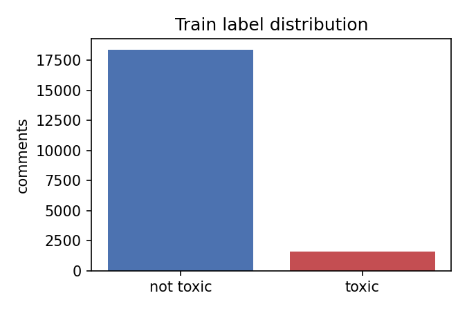
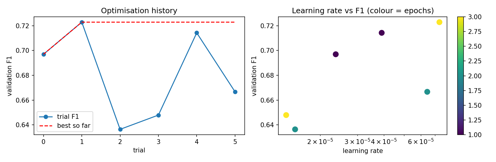
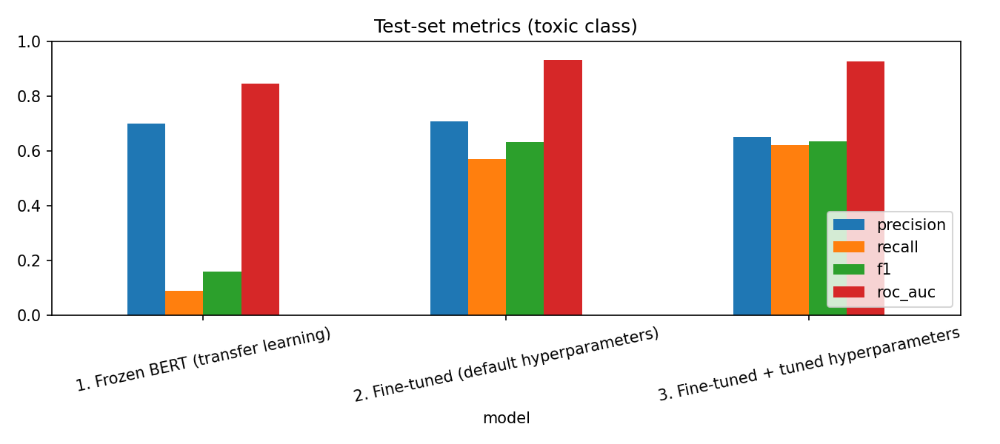
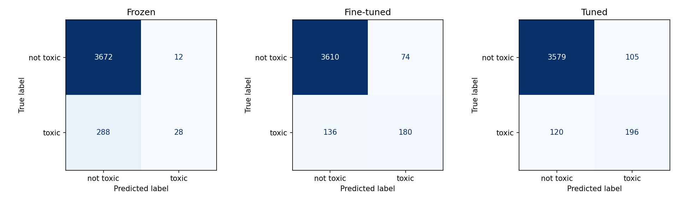
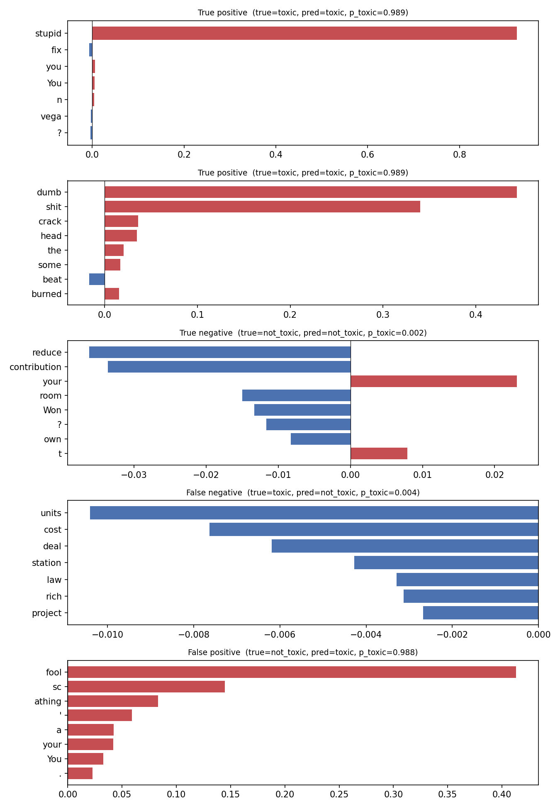

# Assignment 03 — Toxic Comment Classification (Civil Comments)

**Name:** Anika Tabassum Omi  
**Student ID:** 1000129232  
**Program:** Skills for Industry Competitiveness and Innovation Program (SICIP), BRAC University

## 1. Overview

This project classifies a user comment as **toxic** or **not toxic** using the [Civil Comments](https://huggingface.co/datasets/google/civil_comments) dataset. The pipeline covers the four required parts:

1. **Transfer learning:** a pre-trained DistilBERT encoder is frozen and used only as a feature extractor (baseline).
2. **Fine-tuning:** the whole model is unfrozen and trained end-to-end.
3. **Hyperparameter tuning:** an Optuna (TPE) search over the fine-tuned model.
4. **Interpretability:** SHAP explanations for a selected set of predictions.

Main file: `toxicity_classifier.ipynb`. All figures and tables are saved in `results/`.

## 2. Setup

| Item | Value |
|---|---|
| Dataset | `load_dataset("google/civil_comments")` |
| Label rule | `toxicity >= 0.5` → toxic (1), otherwise not toxic (0). **Threshold = 0.5** |
| Sub-sample (random, seed 42) | 20,000 train / 400 validation / 4,000 test (full train split is about 1.8M rows) |
| Toxic share | train 8.06%, validation 9.75%, test about 7.9% (316 of 4,000) |
| Max sequence length | 128 tokens, dynamic padding |
| Hardware | Google Colab, NVIDIA T4 GPU, fp16 |
| Library | transformers 5.22.2 (Hugging Face `Trainer`) |
| Metrics | accuracy, precision, recall, F1 and ROC-AUC (precision/recall/F1 for the toxic class) |

The data is strongly imbalanced, as the figure shows. A model that always answers "not toxic" would already reach about **92.1% accuracy** (3,684 of 4,000 test comments), so **F1 and recall on the toxic class** are the metrics that matter, not accuracy.



The validation set was used for model selection (best epoch and tuning). The test set was used only for the final reported numbers.

## 3. Model choice

**Model:** `distilbert-base-uncased` (66,955,010 parameters).

**Why:**
- It is BERT-based, as required, but has 6 transformer layers instead of 12. Its authors report it is about 40% smaller and about 60% faster than BERT-base while keeping about 97% of its language-understanding performance.
- That makes it practical for a free Colab T4 GPU. The pipeline trains the model several times (frozen, fine-tuned, 6 tuning trials, final retrain), so speed matters.
- Comments are short and informal, and toxicity depends mostly on word choice, so a smaller model is a reasonable trade-off.
- Limitation: the "uncased" version lowercases text, so it loses capitalisation cues such as SHOUTING.

## 4. Results without tuning

Test-set results (4,000 comments, 316 toxic):

| Model | Accuracy | Precision | Recall | F1 | ROC-AUC |
|---|---|---|---|---|---|
| 1. Frozen encoder (transfer learning) | 0.9250 | 0.7000 | 0.0886 | 0.1573 | 0.8447 |
| 2. Fine-tuned (default hyperparameters) | 0.9475 | 0.7087 | 0.5696 | 0.6316 | 0.9316 |

Default fine-tuning settings: learning rate 2e-5, 2 epochs, batch size 32, weight decay 0.01, warm-up ratio 0.1. The frozen baseline used learning rate 1e-3, 3 epochs, batch size 64.

**Justification:**
- **Frozen encoder.** Only the small classification head is trained: 592,130 of 66,955,010 parameters (0.88%). The pre-trained features are general-purpose language features that were never trained to separate toxic from non-toxic text, so a small head on top cannot do much. The confusion matrix shows the result: it detects only 28 of 316 toxic comments (recall 0.089), so its F1 is just 0.157. Its accuracy of 0.925 is barely above the 0.921 majority-class baseline, which shows why accuracy is misleading here. The ROC-AUC of 0.845 shows the features do contain some signal, but at the 0.5 decision threshold the model almost never says "toxic".
- **Fine-tuned model.** With all 66,955,010 parameters trainable (100%), the encoder adapts its representations to toxic language. Recall jumps from 0.089 to 0.570 and F1 from 0.157 to 0.632. ROC-AUC rises from 0.845 to 0.932. This is the main gain of the whole pipeline, and it shows that adapting the encoder matters much more than training only a head.
- Precision stayed similar (0.70 vs 0.71), so the improvement comes almost entirely from finding many more toxic comments.

## 5. Hyperparameter tuning

**Method:** Optuna with the TPE (Bayesian) sampler, 6 trials, seed 42. Objective: maximise **validation F1** of the toxic class. Each trial trains a fresh model on a smaller training subset (8,000 comments) to keep the search affordable. The best configuration is then retrained on the full 20,000-comment training subset.

**Search space:**

| Hyperparameter | Range |
|---|---|
| Learning rate | 1e-5 to 1e-4 (log scale) |
| Batch size | 16, 32, 64 |
| Epochs | 1 to 3 |
| Weight decay | 0.0 to 0.1 |
| Warm-up ratio | 0.0 to 0.2 |

**Screenshot of the tuning results:**



**Trial results** (sorted by validation F1, from `results/tuning_trials.csv`):

| Trial | Val F1 | Batch | Epochs | Learning rate | Warm-up | Weight decay |
|---|---|---|---|---|---|---|
| **1 (best)** | **0.7229** | 32 | 3 | 7.35e-05 | 0.042 | 0.083 |
| 4 | 0.7143 | 32 | 1 | 3.91e-05 | 0.193 | 0.095 |
| 0 | 0.6970 | 16 | 1 | 2.37e-05 | 0.012 | 0.016 |
| 5 | 0.6667 | 64 | 2 | 6.43e-05 | 0.099 | 0.012 |
| 3 | 0.6479 | 64 | 3 | 1.38e-05 | 0.103 | 0.020 |
| 2 | 0.6364 | 64 | 2 | 1.52e-05 | 0.122 | 0.029 |


**Best parameters** (saved in `results/best_params.json`): learning rate 7.35e-05, batch size 32, 3 epochs, weight decay 0.0832, warm-up ratio 0.0425.

**Observations:** the two best trials used a medium batch size (32) and a relatively high learning rate (about 4e-5 to 7e-5). The worst trials combined batch size 64 with a low learning rate (about 1.4e-5 to 1.5e-5). That means fewer, smaller weight updates, so the model was under-trained on the 8,000-comment subset. Validation F1 varied from 0.636 to 0.723 across only six trials, so the search is sensitive to these settings.

## 6. Results with tuning

| Model | Accuracy | Precision | Recall | F1 | ROC-AUC |
|---|---|---|---|---|---|
| 1. Frozen encoder | 0.9250 | 0.7000 | 0.0886 | 0.1573 | 0.8447 |
| 2. Fine-tuned (default) | 0.9475 | 0.7087 | 0.5696 | 0.6316 | 0.9316 |
| 3. Fine-tuned + tuned | 0.9438 | 0.6512 | 0.6203 | 0.6353 | 0.9265 |




| Confusion matrix (test) | TN | FP | FN | TP |
|---|---|---|---|---|
| Frozen | 3672 | 12 | 288 | 28 |
| Fine-tuned (default) | 3610 | 74 | 136 | 180 |
| Fine-tuned + tuned | 3579 | 105 | 120 | 196 |

**Justification:**
- **Tuning changed the trade-off but gave almost no net gain.** Test F1 went from 0.6316 to 0.6353, a difference of only +0.004. With just 316 toxic test comments, a change that small is within noise and should not be called a real improvement.
- **What did change:** the tuned model catches more toxic comments (TP 180 → 196, recall 0.570 → 0.620) but also raises more false alarms (FP 74 → 105, precision 0.709 → 0.651). Its accuracy (0.9438 vs 0.9475) and ROC-AUC (0.9265 vs 0.9316) are slightly lower. Which model is better depends on the use case: if missing toxic comments is more costly than flagging harmless ones (for example, moderation with human review), the tuned model is preferable.
- **Why the gain is small:** the default settings (learning rate 2e-5, batch 32) were already reasonable for BERT-style models, and the search was small (6 trials) and ran on an 8,000-comment subset. The validation set is also tiny (400 comments, about 39 toxic), so the validation F1 used to pick the best trial is noisy. The best validation score (0.723) may be partly luck and did not carry over to the test set.
- The largest effect in this assignment is fine-tuning versus freezing, not tuning versus default fine-tuning.

## 7. Real-world text test

Predictions from the tuned model (`results/real_world_predictions.csv`):

| Source | Input | Predicted class | P(toxic) | Check of the prediction |
|---|---|---|---|---|
| News comment | "Thanks for the thoughtful article, I learned a lot about the new policy." | not_toxic | 0.0028 | Correct. Polite, positive comment. |
| Forum reply | "You are a complete idiot and nobody wants to hear your garbage opinions." | toxic | 0.9874 | Correct. A direct personal insult. |
| Sarcasm | "Oh great, another genius idea from management. What could possibly go wrong?" | not_toxic | 0.0048 | Acceptable. Mildly sarcastic, but with no insult or slur, so most annotators would likely not call it toxic. It shows the model reads words, not tone. |
| Heated debate | "I strongly disagree with this decision and I think it will hurt local businesses." | not_toxic | 0.0042 | Correct. Strong disagreement is not toxicity. |
| Review | "The delivery was late and the food was cold, very disappointing experience." | not_toxic | 0.0061 | Correct. Negative sentiment is not the same as toxicity. |
| Insult | "Shut up, you worthless moron. People like you shouldn't be allowed to post." | toxic | 0.9877 | Correct. Insulting and dismissive. |

The model separates insults from merely negative or critical text well, and it is very confident (probabilities close to 0 or 1). The weak spot is implicit toxicity such as sarcasm, which has no obvious offensive words.

## 8. Interpretability (SHAP)

**Why SHAP:** SHAP gives each token a Shapley value that shows how much it pushed the prediction towards (positive) or away from (negative) the **toxic** class. It works directly with the Hugging Face pipeline without changing the model, and it gives per-token explanations that are easy to read next to the text. I explained five test-set predictions: two true positives, one true negative, one false negative and one false positive. The error cases are the most informative.



Full interactive view: [`results/shap_text.html`](results/shap_text.html) (open in a browser).

| Case | True → Predicted | P(toxic) | Main tokens |
|---|---|---|---|
| True positive 1 | toxic → toxic | 0.989 | "stupid" (about +0.93) |
| True positive 2 | toxic → toxic | 0.989 | "dumb" (about +0.44), "shit" (about +0.34) |
| True negative | not toxic → not toxic | 0.002 | "reduce", "contribution", "room" (small negative values) |
| False negative | toxic → not toxic | 0.004 | "units", "cost", "deal", "station", "law" (all negative) |
| False positive | not toxic → toxic | 0.988 | "fool" (about +0.41), "scathing" word-pieces |

**Analysis:**
- **True positives.** The model relies on clear insult words. In "You can't fix stupid" almost the whole prediction comes from the single token "stupid". In the second comment "dumb" and "shit" dominate, while neutral words add very little. This is sensible, and it shows the model has learned the vocabulary of insults.
- **True negative.** "Won't this reduce your own contribution room?" is a neutral financial question. All tokens have small values (about ±0.03) and the probability is 0.002. The model is confidently non-toxic for plain topical language.
- **False negative.** This is a political comment about low-cost housing. Its SHAP values are all negative, with topical words like "units", "cost", "law" pushing towards non-toxic, and no insult words. The dataset labels it toxic, probably because of hostility towards "the rich" or content later in the text that was cut off: the text used for the SHAP analysis was truncated to 400 characters (it ends mid-sentence). So the model made a reasonable decision on the visible text. This shows its limit: toxicity that is expressed through tone, ideology or implication, and not through offensive words, is missed. It also shows that the labels themselves are noisy.
- **False positive.** "You're known for your scathing wit, not a DonInKansas fool's laugh." was flagged at 0.988 mainly because of "fool" (about +0.41) and the word-pieces of "scathing" ("sc", "athing"). The sentence is a sarcastic insult aimed at one person, so it is borderline, but annotators did not rate it as toxic enough. The model reacts to insult-like words without understanding context or the literary tone, which makes it over-sensitive. A bad label is another possible explanation.
- **Overall:** the explanations show the model is driven by lexical cues. That works well for obvious insults and fails for sarcasm, context and implicit hostility, which matches the real-world test in Section 7.

## 9. Limitations and possible improvements

- The validation set has only 400 comments (about 39 toxic), so tuning decisions are noisy. A larger validation set would make model selection more reliable.
- Only 6 tuning trials, each on an 8,000-comment subset, and a single random seed. Results could change with other seeds.
- Training used only a 20,000-comment subset of about 1.8 million comments.
- The loss was not class-weighted, which probably contributes to the low recall of the frozen model. A weighted loss or tuning the decision threshold could raise recall.
- Civil Comments labels come from averaged annotator scores, so the 0.5 threshold creates borderline cases, as seen in the SHAP examples.
- The model can be sensitive to identity and charged words, so it should not be used for automatic moderation without human review.

## 10. How to run

```bash
python -m venv .venv
.venv\Scripts\activate            # Mac/Linux: source .venv/bin/activate
pip install -r requirements.txt
jupyter lab                       # or open toxicity_classifier.ipynb in VS Code
```

Select the project kernel and run all cells. On a laptop without a good GPU, use Google Colab with a T4 GPU runtime (`!pip install -q optuna shap datasets accelerate`, then Run all). Results are saved in `results/`; the trained model is saved in `outputs/best_model` (not committed).

## 11. Repository files

- `toxicity_classifier.ipynb`: full pipeline
- `README.md`: this report
- `requirements.txt`: dependencies
- `results/`: figures, CSV tables, `best_params.json`, `shap_text.html`
- `github_link.txt`: repository link
- `main.py`: helper script that builds the submission zip (notebook, README, requirements and `results/` only, with no dataset or model files)